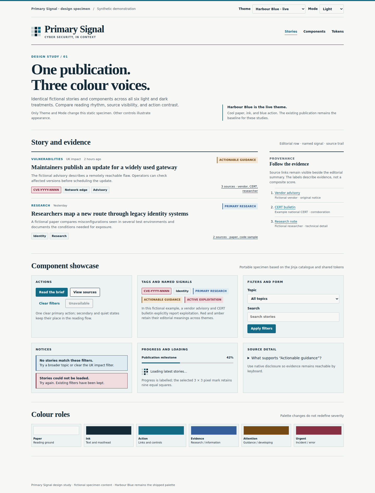
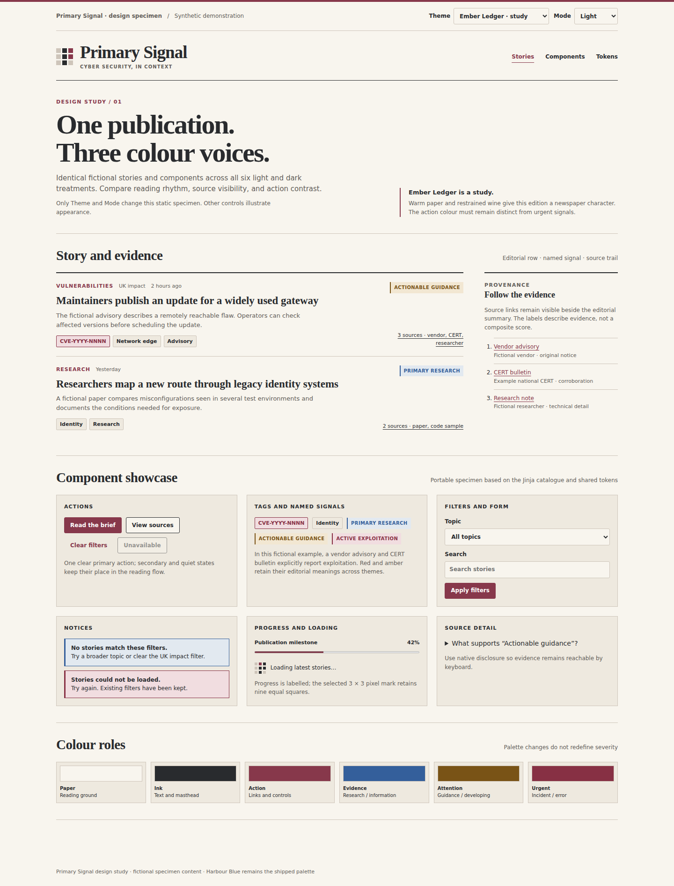
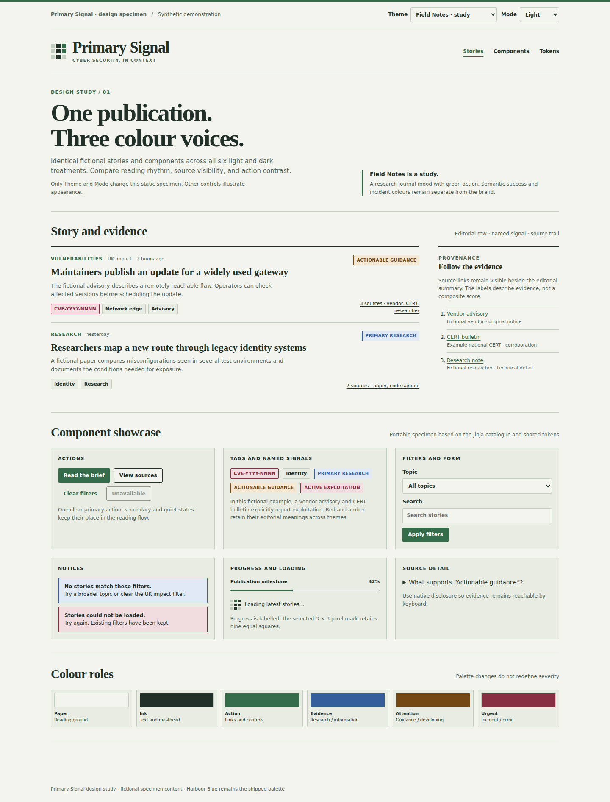
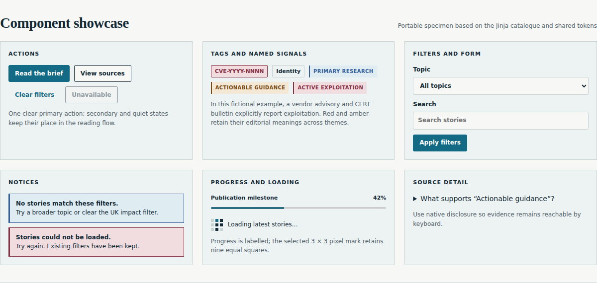
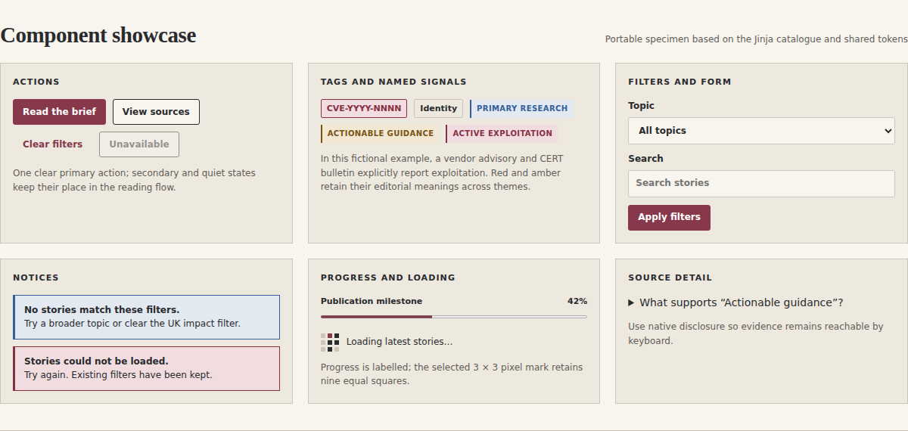
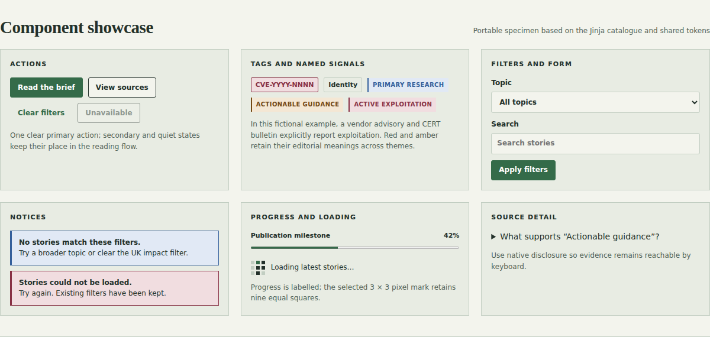

# Primary Signal design

Primary Signal is an editorial cyber-security publication. Its interface gives
the story, source trail and named evidence room to breathe. The selected
[Harbour Blue](docs/design/harbour-blue.md) theme is the live design in light
and dark modes. [Ember Ledger](docs/design/ember-ledger.md) and
[Field Notes](docs/design/field-notes.md) are documented studies, not shipping
theme choices.

## Compare the themes

Each study uses the same fictional story and the selected 3×3 Spectrogram P.
The palette and reading rhythm change; the information and component meanings
do not. Open the [hosted component showcase](https://mravalanche.github.io/primarysignal/design/component-showcase.html)
to switch between light and dark examples, or inspect its
[HTML source](design/component-showcase.html).

| Harbour Blue · selected | Ember Ledger · study | Field Notes · study |
| --- | --- | --- |
|  |  |  |
| Calm, technical publication | Warm newspaper character | Research-journal restraint |

The [theme pages](docs/design/README.md) include light and dark images, core
tokens, component behavior and the trade-offs behind each direction. The
[selected design system](docs/design-system.md) is the implementation reference
for Harbour Blue; the studies do not change the public site.

### Component details

The same controls, named signals and states are shown in each palette. These
snippets make their changed emphasis easier to compare without scrolling
through the full page.

| Harbour Blue | Ember Ledger | Field Notes |
| --- | --- | --- |
|  |  |  |

## What stays constant

- **Identity:** the equal-square 3×3 Spectrogram P and an editorial wordmark.
- **Reading order:** headline, useful summary, source provenance, then named
  evidence and technical metadata. No composite confidence score.
- **Components:** story rows, source trails, named signals, subject tags,
  filters, controls, alerts and empty states use one shared vocabulary.
- **Semantics:** red, amber and other evidence cues retain their named meaning.
  The theme accent is for links, focus and primary actions; colour never stands
  alone as a status label.
- **Form:** Charter-family headlines, system UI text, thin rules, square-leaning
  controls, a readable column, and light and dark surfaces. Component meaning
  and keyboard behavior remain the same across modes.

The public and administration interfaces may differ in density, but should
share these foundations. Tailwind and a constrained DaisyUI subset provide
primitives; Primary Signal's Jinja components define the publication patterns.

## Design process

1. Compare the same fictional content across each theme in the showcase.
2. Review both modes at desktop and mobile widths. Check text and control
   contrast, focus, source provenance and semantic cues.
3. Keep Harbour Blue as the implementation baseline. Any proposal to ship a
   different theme needs an explicit selection, token mapping and component
   review before it changes the site.
4. Update this page, the relevant theme page, the showcase and its images when
   a design decision changes. The [delivery plan](docs/PLAN.md) tracks work to
   release rather than visual preference.

All stories, publishers and dates in the showcase are fictional. The images
are design references, not evidence of live news coverage.
