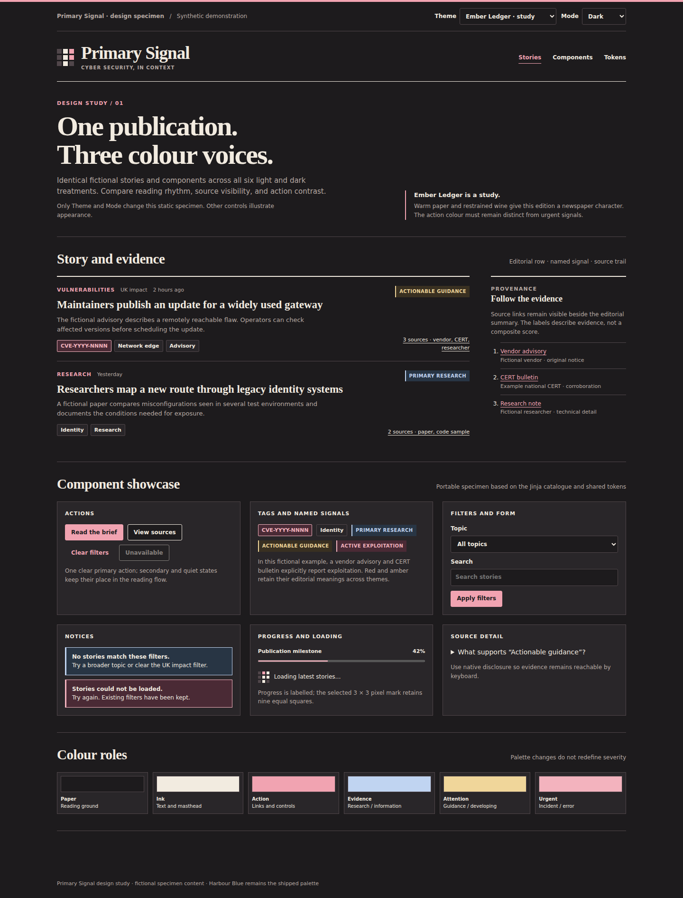

# Ember Ledger

**Status:** exploratory study. Warm paper, dark graphite ink and a wine accent
give the publication a more traditional newspaper character. The accent can
feel urgent beside an incident or exploitation label, so components must keep
those meanings explicit.

[Back to the design comparison](../../DESIGN.md) ·
[Open the component showcase](../../design/component-showcase.html) ·
[Selected design system](../design-system.md)

## Light and dark studies

| Core role | Light study | Dark study |
| --- | --- | --- |
| Paper | `#F8F5EE` | `#1D1B1D` |
| Main ink | `#292B2E` | `#F2EBE0` |
| Action accent | `#87384B` | `#F1A3B1` |

These are study values, not runtime tokens. Panel, rule, muted-text, hover,
focus and semantic token mappings need contrast review before this direction
could be implemented. The images show a visual proposal rather than a
validated accessible theme.

## Component behavior

- Keep the selected 3×3 Spectrogram P and equal pixel geometry. The bowl may
  use the theme action accent in the study; its shape does not change.
- Use the same headline, summary, metadata and source order as Harbour Blue.
  Warm paper must not reduce the visibility of source panels or thin rules.
- Keep navigation/action wine separate from red incident rails and red active
  exploitation signals. Labels and evidence text carry the distinction.
- Keep advisory amber, research teal and the existing named signal meanings.
  Do not recolour them to match the theme accent.
- Test controls, focus, filters, alerts and empty states in both modes at
  mobile width before considering this a viable replacement.

## Trade-off

Ember Ledger has a distinctive editorial warmth. Its main risk is ambiguity
between brand accent and urgent evidence cues. It stays a study while Harbour
Blue remains the live design.
