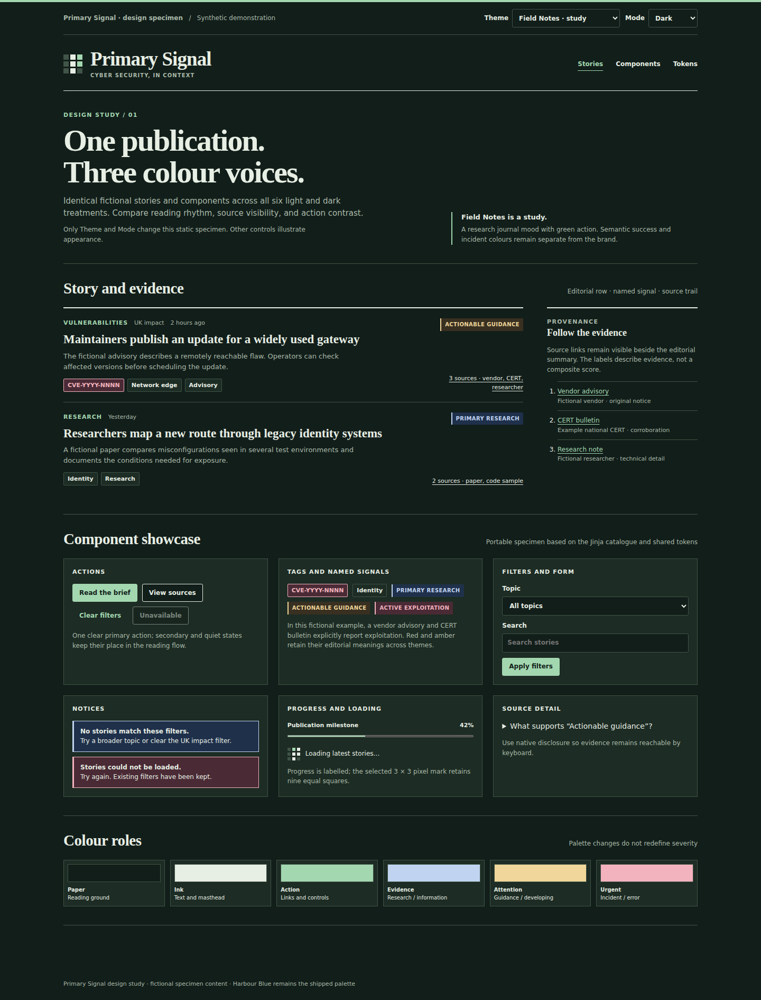

# Field Notes

**Status:** exploratory study. Pale olive paper and deep green ink suggest a
research notebook. The result is quiet and methodical, but green also has an
established success meaning in many interfaces. An action link must never be
mistaken for a verified outcome.

[Back to the design comparison](../../DESIGN.md) ·
[Open the component showcase](../../design/component-showcase.html) ·
[Selected design system](../design-system.md)

## Light and dark studies

| Core role | Light study | Dark study |
| --- | --- | --- |
| Paper | `#F3F4ED` | `#121E1A` |
| Main ink | `#22302A` | `#E7EEE4` |
| Action accent | `#346B49` | `#A3D7B0` |

These are study values, not runtime tokens. Panel, rule, muted-text, hover,
focus and semantic token mappings need contrast review before this direction
could be implemented. The images show a visual proposal rather than a
validated accessible theme.

## Component behavior

- Preserve the selected 3×3 Spectrogram P and equal pixel geometry. The bowl
  takes the study accent; the mark's meaning stays the same.
- Keep story hierarchy and source provenance unchanged. Neutral source cards
  should remain distinct from action links and named evidence signals.
- Do not use the brand green as a success, verified, safe or low-risk label.
  Those states need explicit words and separately reviewed semantic colours.
- Keep red and amber evidence cues and subject tags in their established
  roles. A named signal still needs qualifying evidence and an explanation.
- Check filters, focus, controls, alerts and empty states in both modes and at
  mobile width before considering implementation.

## Trade-off

Field Notes offers a measured tone for long reading. Its green accent needs
careful separation from success semantics. It stays a study while Harbour
Blue remains the live design.
