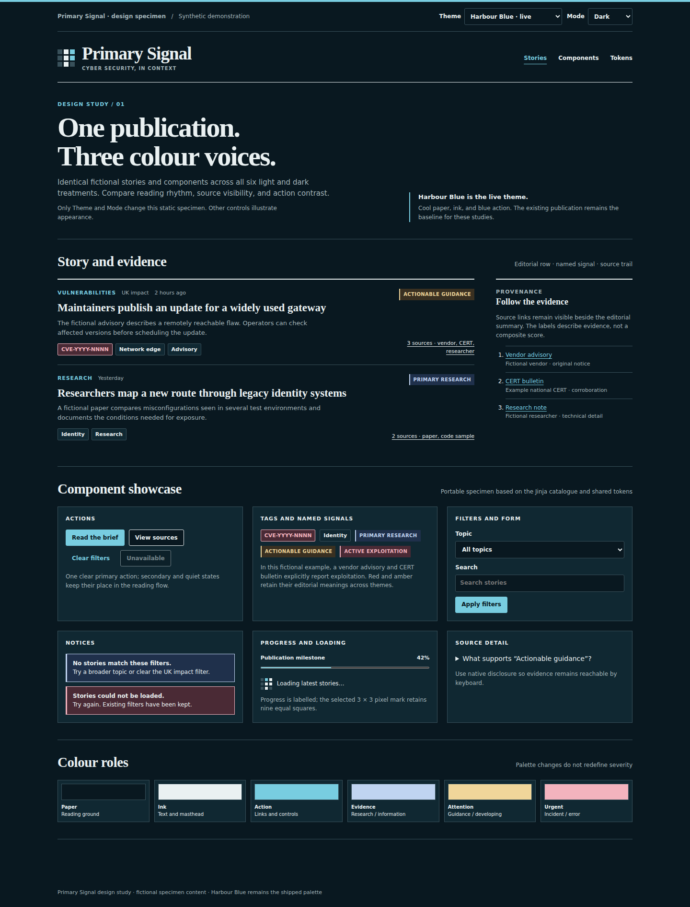

# Harbour Blue

**Status:** selected; live in light and dark modes. This is the baseline for
the public site and shared UI foundations. Its cool paper and blue action
colour give technical material a calm reading surface without making an
evidence signal look like a navigation cue.

[Back to the design comparison](../../DESIGN.md) ·
[Open the component showcase](../../design/component-showcase.html) ·
[Implementation tokens and rules](../design-system.md)

## Light and dark studies

| Role | Light | Dark |
| --- | --- | --- |
| Paper | `#F7F8F6` | `#091820` |
| Main ink | `#142B37` | `#EAF1F2` |
| Panel | `#EDF2F2` | `#102832` |
| Rule | `#C8D3D4` | `#38505A` |
| Muted text | `#52616A` | `#A3B4B9` |
| Action / P bowl | `#126A85` | `#78CDE0` |

These values map to the `--ps-neutral-*` and `--ps-brand-blue-strong` tokens in
`frontend/styles/foundation.css`. The [design system](../design-system.md)
defines the full ramps, semantic aliases, contrast checks and DaisyUI mapping.

## Component behavior

- The masthead uses the selected 3×3 Spectrogram P. All nine grid cells are
  equal squares; the lit stem is ink and the bowl is the action blue.
- Story rows use a serif headline, an ordinary-language summary and compact
  metadata. A labelled article-type rail can add a cue without carrying its
  meaning alone.
- Source trails name the publisher and source role. Links use the action blue;
  source panels remain neutral so provenance stays distinct from status.
- Named signals pair a label and explanation with evidence. Amber marks an
  actionable signal and red marks active exploitation only when the stated
  evidence qualifies. Subject tags do not imply severity.
- Filters, buttons and form fields use the same square-leaning controls and
  visible focus treatment in both modes. Alerts and empty states use plain
  labels; a colour change is supplemental.

## Decision and limits

Harbour Blue is already implemented. Keep its current semantic colours and
shared component rules while refining page layouts. Review any proposed new
colour pair in both modes and on mobile before adding it to the system. The
showcase uses fictional examples and does not imply live coverage.
